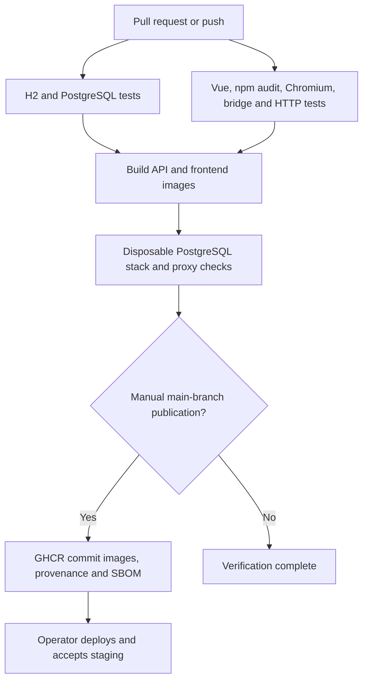

# Verification and delivery

## GitHub Actions

Commit this project at the repository root. `verify.yml` runs on pull requests, main/master pushes and manual dispatch. Actions are pinned by SHA; Dependabot proposes Maven, npm, Actions and Docker updates.



The same backend tests target H2 and PostgreSQL 17. Browser/HTTP acceptance uses synthetic credentials and fresh H2 databases. Image checks start a disposable PostgreSQL stack, run the accumulated HTTP example against the packaged API and check frontend/proxy health. Cleanup deletes only CI's disposable volume. These jobs are configured, but have not run remotely from this workspace.

Enable branch protection requiring backend, client-and-acceptance and image-builds checks. Restrict publication permissions. On a manual main-branch dispatch with `publish` selected, successful checks produce `ghcr.io/<owner>/<repository>-api:<commit>` and `-frontend:<commit>`. Prefer resulting digests for deployment. The owner must configure GitHub/package permissions and private registry authentication. The workflow publishes images; it does not deploy a live host.

## Staged production setup

Finish priority-one requirements in REVIEW.md before a pilot. Provision identity roles/subjects, a TLS reverse proxy, secrets, monitoring, backups, allowed device networks and retention. Automatic browser OIDC login/refresh/logout remains pending; manual bearer entry is available for controlled testing.

`compose.production.yaml` uses verified images and JWT authentication. It exposes only loopback:8081, has no host API port, and gives the API a read-only filesystem with temporary `/tmp`. AI defaults to disabled. Keep the project name stable to retain the intended volume.

```bash
cp .env.production.example .env.production
chmod 600 .env.production
```

Replace placeholders with verified image digests, database secret and actual OIDC settings. Never commit real values. Validate without printing resolved secrets:

```bash
docker compose --env-file .env.production -f compose.production.yaml -p plastiflow config --quiet
docker compose --env-file .env.production -f compose.production.yaml -p plastiflow pull
docker compose --env-file .env.production -f compose.production.yaml -p plastiflow up -d --wait --wait-timeout 180
curl --fail http://127.0.0.1:8081/actuator/health
```

Point your TLS reverse proxy to loopback:8081. Inspect logs/migration history and exercise real-role workflows on staging. Demo scripts require fresh disposable data; do not run them on production records.

## Backup and recovery

Before an upgrade, save a database dump, prior image digests and secure configuration:

```bash
mkdir -p backups
chmod 700 backups
umask 077
docker compose --env-file .env.production -f compose.production.yaml -p plastiflow exec -T database pg_dump -U plastiflow -d plastiflow -Fc > backups/plastiflow-before-upgrade.dump
```

Check command success and dump size, then copy to encrypted off-host storage. A database volume is not a backup. Test restoration in an empty, disposable database with a new volume and compatible PostgreSQL version. For a separately prepared `restore-check` project:

```bash
docker compose -p restore-check exec -T database pg_restore -U plastiflow -d plastiflow --no-owner --exit-on-error < backups/plastiflow-before-upgrade.dump
```

Check row counts, journal balances, consumption history and payroll totals. Start the matching application version against the restored database and exercise representative workflows. This restore drill was not performed during the review.

Upgrade staging first, then change production image references during an agreed maintenance window. Flyway applies V7/V8; preserve V1–V6. Do not use `repair` to bypass checksum failures. If migration/health fails, stop rollout and inspect logs. Image rollback alone is not a database rollback: restore the prior backup into a separate recovery database, use matching prior images and account for writes since backup before switching traffic. Never delete the live volume.

## Verification limits

Docker/PostgreSQL tooling was unavailable locally. Actual container execution, remote CI, GHCR publication, deployed OIDC/TLS, load/monitoring acceptance and backup restoration remain pending. Static validation and H2/browser tests do not establish that these external operations succeeded.

References: [GitHub image publication](https://docs.github.com/en/actions/tutorials/publish-packages/publish-docker-images), [Playwright CI](https://playwright.dev/docs/ci).
