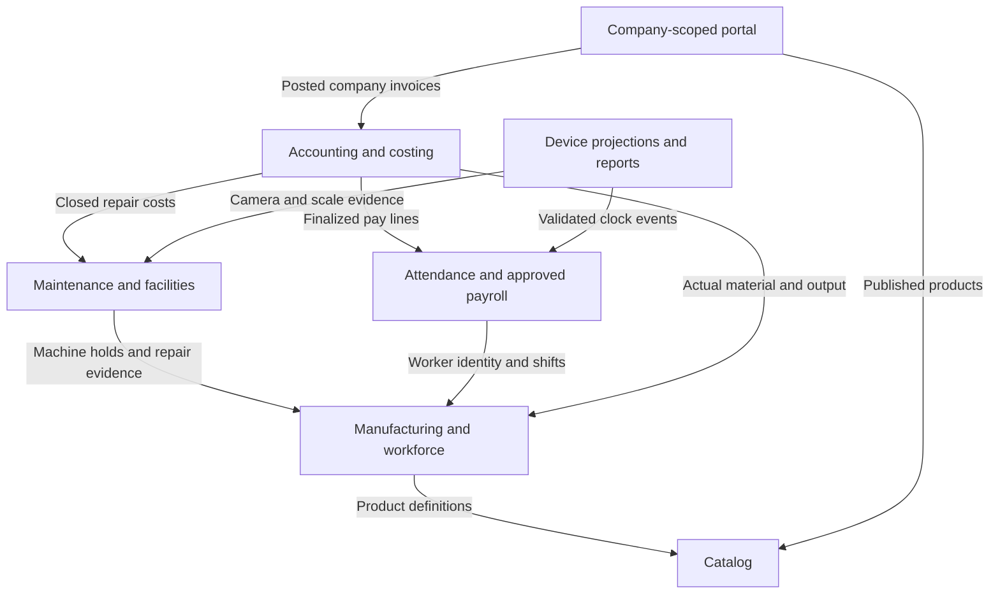
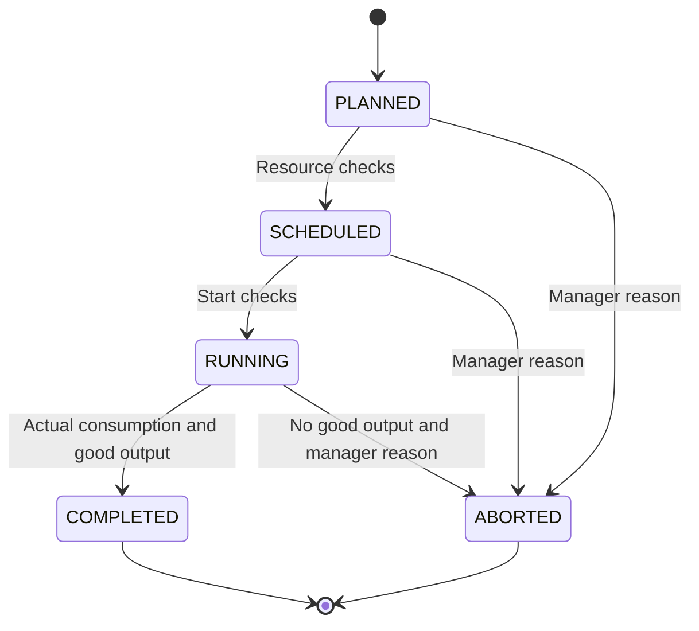
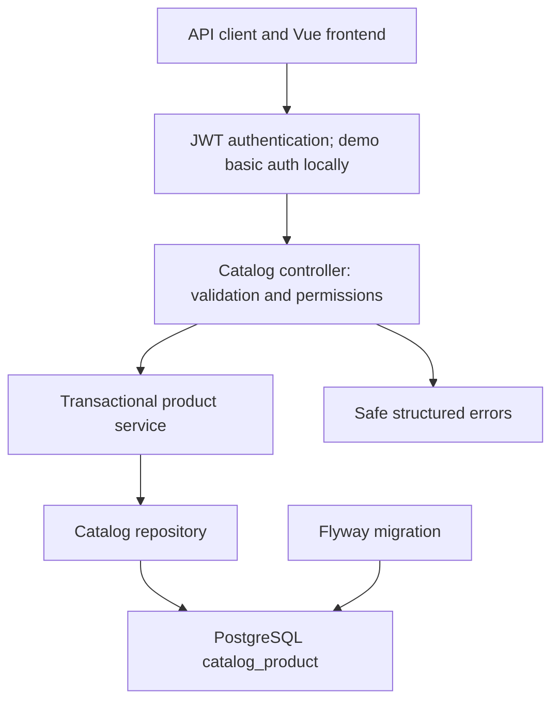
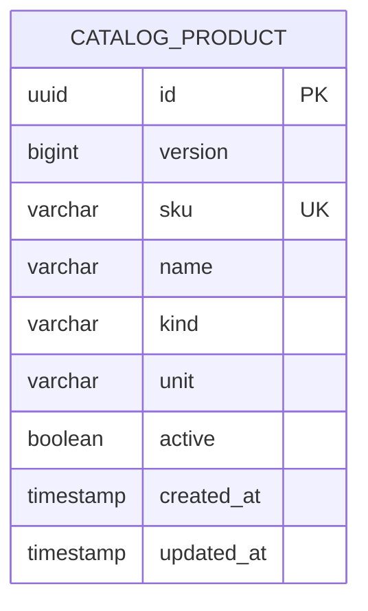

# Accumulated concept design · 0.7.0

One Java backend owns several domain modules in a shared transactional database. One Vue client presents department workspaces according to authenticated roles. This is a modular monolith; separate deployment of domain services and independent databases would require a different architecture and distributed transaction/event design.

Routes authenticate JWTs and enforce roles before transactional domain operations. Public module gateways retain domain validation. The integration AI adapter consumes prepared report aggregates; its provider call runs outside database locks and does not mutate inventory, payroll or journals. Portal requests require factory review and do not create stock reservations automatically.

Completed and aborted schedules remain historical evidence and stop reserving calendars. Good output requires completion/quality review; abort preserves consumed stock and rejects without a stock return. Canceled maintenance windows remain visible history and do not release work-order machine holds.

Existing module-specific concept diagrams and programming tables are in the manufacturing, operations, payroll, finance and integration guides. General factory/department object scoping and the complete supply chain remain pending. CI/delivery topology is in DEPLOYMENT.md.

## Catalog and module details

### Catalog foundation

## Business invariants

1. SKU is uppercase ASCII, starts with a letter/digit, maximum 40 characters; remaining characters may include dots, underscores and hyphens.
2. Product name is nonblank and at most 160 characters; surrounding whitespace is removed.
3. Kind and base unit are explicit enum values. Product-specific conversion factors are a future feature.
4. SKU, kind and base unit remain immutable to protect later inventory and document semantics.
5. Products are deactivated rather than deleted.
6. Updated records require the last-read version; the database version column also protects concurrent writes.
7. Availability is not a field on a catalog product. It will be calculated by inventory using locations, lots, quality status and reservations.
8. General factory scope remains pending. Version 0.7 adds transactional catalog audit records; created_at/updated_at alone are record metadata.

## Errors

| HTTP | Code | Meaning |
|---|---|---|
| 400 | INVALID_REQUEST | Invalid fields, UUID, enum or query parameters |
| 401 | Security response | Missing or invalid authentication |
| 403 | Security response | Authenticated user lacks the required role |
| 404 | PRODUCT_NOT_FOUND | No product with the supplied identifier |
| 409 | CATALOG_CONFLICT | Duplicate SKU or catalog integrity constraint |
| 409 | STALE_VERSION | A product was updated since the client's last read |

Validation/business errors use ProblemDetail with a stable `code`. Security-layer 401/403 responses are framework responses and may have a different body shape. Full text-search indexing, multi-factory access, idempotent create keys, audit retention/export and complete OpenAPI documentation belong to later increments.

## Financial module

Version 0.5 adds `finance` alongside catalog, manufacturing, operations and payroll in the same backend. `AccountingService` owns posted journals and source documents; `CostRecyclingService` owns analytic allocations and stock recovery. V5 tables share database transactions with existing lots and preserve original source references. The module uses a database serialization row for cross-request caps and posting uniqueness. See FINANCIAL.md for three concept diagrams and programming steps 26–30. This architecture is a modular monolith, not independently deployed microservices.

## Integration module

Version 0.6 adds `integration` with registry/inbox, report, AI and partner-portal services. An edge Python process stores an offline SQLite outbox and submits stable event UUIDs. Domain gateways retain the original payroll clock and operations validation. Portal scope is derived from the authenticated subject; AI consumes prepared production aggregates and never mutates business records. Network calls occur outside transactional locks, with attempt checks on results. V6 adds integration tables without altering previous migrations. Read INTEGRATION.md for device and AI concept diagrams and the programming table.
