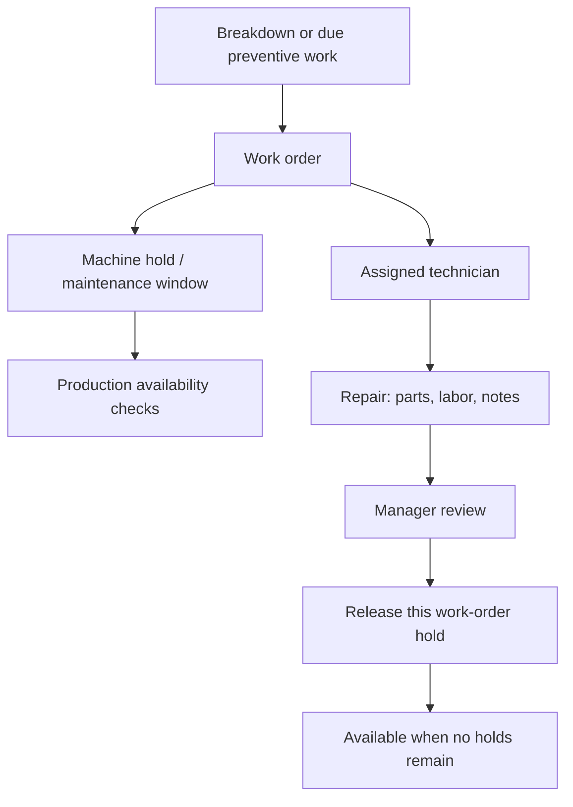
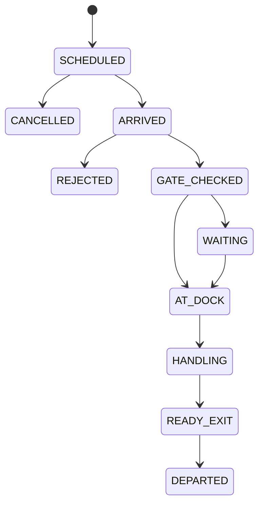
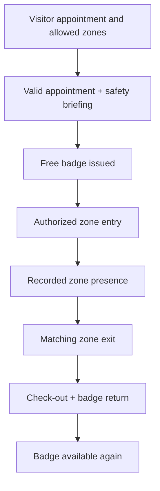

# Factory-operations increment: steps 19–22

Version 0.3 extends the catalog and manufacturing application with four working operational areas. The archive includes the previous code, not just the new modules.

| Step | Service | Implemented foundation |
|---|---|---|
| 19 | Maintenance | Machine breakdowns, assigned technicians, preventive plans by calendar date, maintenance windows, spare receipts/usage, labor costs, repair review and approved return to service |
| 20 | Infrastructure | Factory areas, utility/building assets, condition inspections, facility repair work and service-contract records |
| 21 | Truck yard | Appointments, dock bookings, arrival, gate approval/rejection, parking/dock occupancy, handling, weight tickets, document confirmation and departure |
| 22 | Physical access | Visitor/contractor appointments, hosts, authorized zones, safety briefing, badges, zone entry/exit, badge-return confirmation, incidents and camera register/status |

## Run and upgrade

Keep your existing database volume and `.env`. Add the six new passwords listed in `.env.example`, using distinct random values with at least 16 characters:

- MAINTENANCE_PASSWORD
- TECHNICIAN_PASSWORD
- FACILITIES_PASSWORD
- LOGISTICS_PASSWORD
- SECURITY_PASSWORD
- GATE_PASSWORD

Version 0.3 used 13 values; version 0.4 additionally requires the two payroll passwords. The operations baseline has 13 configured values: one database password and 12 account passwords. Then run:

```bash
docker compose up --build -d
```

Open `http://localhost:8081`. Selecting an operations account chooses the appropriate workspace. OIDC developers can explicitly choose Factory operations and a department at the login screen. Passwords/tokens remain in memory only.

| Demo account | Backend role | Main responsibility |
|---|---|---|
| maintenance | MAINTENANCE_MANAGER | Work orders, plans, technicians, parts and return to service |
| technician | MAINTENANCE_TECHNICIAN | Their own assigned repairs, parts and labor |
| facilities | FACILITIES_MANAGER | Areas, infrastructure assets, inspections and contracts |
| logistics | LOGISTICS_MANAGER | Appointments, docks, parking and handling |
| security | SECURITY_MANAGER | Visitor permissions, badges, zones, incidents and cameras |
| gate | GATE_OFFICER | Truck entry/exit and visitor checkpoints |

For the technician demo account, create a technician whose `userSubject` is `technician`. In OIDC mode use the token subject. Role separation is enforced by the API even when a UI action is visible.

Flyway retains V1 and V2 and applies V3. Test the upgrade against disposable PostgreSQL before using real data; PostgreSQL/container execution has not been verified here. Reuse the original Compose project name if changing directory names so you retain the intended database volume. Do not delete volumes to upgrade.

## Example workflows

With the local demo stack running:

```bash
python scripts/demo_factory_operations.py
```

The script reads passwords from `.env` or environment variables, creates four new examples, checks their final states and prints their identifiers. It is a demonstration that writes records, not a database reset.

### Maintenance

1. Maintenance manager opens a BREAKDOWN work order for a machine.
2. A machine hold makes the machine unavailable for scheduling and job start.
3. Manager assigns a registered technician.
4. Technician starts repair after the ERP production job has stopped/completed.
5. Parts and labor are recorded with explicit event identifiers.
6. Technician submits repair notes for review.
7. Maintenance manager approves return to service.
8. The machine's previous availability is restored only when every hold has been released.

Availability cannot be overridden through the manufacturing equipment endpoint while maintenance holds remain. Multiple work orders can hold the same machine. Closing one does not release another.

Preventive plans use a date and day interval. Generate creates a work order only when due and advances the due date by one interval. Generation is manual; there is no background scheduler or operating-hour/cycle trigger in this increment. PREVENTIVE work does not hold the machine at creation, but holds it when repair starts. Book a maintenance window to reserve future capacity; production conflicts must be rescheduled first. Historical windows remain recorded after release.

ERP holds are records, not safety isolation or physical machine commands. Actual industrial safety procedures remain outside this application.

### Infrastructure

An asset is registered under an area and begins UNAVAILABLE pending inspection. A passing inspection makes it available if no repair work remains open. A failed inspection makes it unavailable.

Facility repairs use FACILITY work orders managed by maintenance. After repair submission, a facilities-manager inspection must pass before maintenance can release the asset. An inspection from before repair submission cannot satisfy this requirement. Contracts record supplier references, dates, amount and currency; they do not post invoices or recurring expenses.

### Truck yard

A visit follows:

**SCHEDULED → ARRIVED → GATE_CHECKED → WAITING / AT_DOCK → HANDLING → READY_EXIT → DEPARTED**

- Scheduled visits can be cancelled; gate checks can reject an arrived visit.
- A tractor or trailer cannot have two active visits.
- Bay/dock occupancy is exclusive. A singleton transactional yard lock serializes mutations in this small-factory foundation.
- Dock bookings cannot overlap. Dock assignment requires the visit's booking to match the current time and chosen dock.
- Moving from a bay to a dock frees the old space.
- Handling cannot start before docking.
- Documents must be confirmed before finishing handling and departure.
- Weight tickets are optional. Once one is entered, both TARE and GROSS are required to finish handling. Gross must be at least tare; net = gross − tare.
- Original weight tickets are immutable, and one ticket of each kind is permitted per visit. Exact event retries are safe; changed payloads and duplicate types conflict.
- Departure records its timestamp and frees the occupied space.

Purchase/shipment references are external text references. There is no actual warehouse receiving/loading scan integration yet. Early departure, appointment overruns, weight correction, seal checks and load discrepancy resolution need additional workflows before a factory pilot.

### Physical access

1. Security manager creates zones, badges and a visitor appointment with a host reference and allowed zones.
2. Gate officer confirms current appointment validity and safety briefing, then assigns a free badge.
3. Zone ENTER is permitted only for an authorized zone during the appointment validity window.
4. A visitor is recorded in at most one zone at a time. EXIT must match that current zone.
5. EXIT remains possible after the appointment expires.
6. Check-out requires no recorded zone presence and explicit badge-return confirmation.
7. The badge becomes available to another visitor after check-out.

This is manual access recording. It does not unlock gates, scan fingerprints or connect to badge hardware. Employee access policies, badge revocation/loss procedures, anti-passback hardware and access-control integrations remain pending. Visitor names and driver information are restricted to their respective operations roles, but multi-factory isolation and configurable retention are not implemented.

Cameras contain zone, device name, external VMS identifier and manually reported status. The ERP does not fetch video, store camera credentials, analyze faces or record surveillance footage.

## Costs and stock

Repair cost = sum of spare usage quantity × entered unit cost + sum of recorded labor hours × hourly rate, in the work order's currency.

Spare inventory is a separate minimal maintenance stock ledger referencing catalog SPARE_PART products. Receipts and usage have UUID replay protection and transactional quantity updates. Stock cannot go negative and PIECE quantities must be whole numbers. Usage unit cost is supplied explicitly; automatic valuation, stock transfers, reservations, corrections and accounting posting are not implemented. Contract values and repair costs are records, not completed accounting entries.

## Design diagrams







## API map

All routes start with `/api/v1/operations`. Validated JSON fields are defined in `operations/Requests.java`. Most creates return 201, actions return 204, details return 200, invalid input returns 400 and business conflicts return 409. Unauthorized authentication returns 401; wrong roles or technician assignments return 403.

| Area | Routes |
|---|---|
| Maintenance overview | GET /maintenance/overview |
| Technicians | POST /technicians |
| Work orders | POST /work-orders; GET /work-orders/{id}; PUT /work-orders/{id}/assignment |
| Repair lifecycle | POST /work-orders/{id}/start, /submit, /release |
| Preventive plans | POST /maintenance-plans; POST /maintenance-plans/{id}/generate |
| Capacity windows | POST /work-orders/{id}/windows |
| Parts and labor | POST /parts/receipts; POST /work-orders/{id}/parts, /labor |
| Facilities overview | GET /facilities/overview |
| Infrastructure | POST /areas, /assets, /service-contracts; POST /assets/{id}/inspections |
| Yard overview | GET /yard/overview |
| Yard spaces | POST /yard/spaces |
| Truck appointments | POST /truck-visits; GET /truck-visits/{id}; PUT /truck-visits/{id}/booking |
| Truck lifecycle | POST /truck-visits/{id}/arrive, /gate-check, /handling, /finish, /depart, /cancel |
| Occupancy and weighing | PUT /truck-visits/{id}/space; POST /truck-visits/{id}/weights |
| Security overview | GET /security/overview |
| Zones and badges | POST /zones, /badges |
| Visitors | POST /visitors; GET /visitors/{id}; POST /visitors/{id}/check-in, /access, /check-out, /cancel |
| Incidents | POST /incidents; POST /incidents/{id}/resolve |
| Cameras | POST /cameras; PUT /cameras/{id}/state |

For OIDC add the six operations roles to the realm role claim, retaining existing issuer/audience validation. A complete browser PKCE sign-in flow and a supplied Keycloak realm are still pending.

## Implementation boundaries

`MaintenanceService`, `FacilitiesService`, `YardService` and `AccessService` own the operations rules and tables. `OperationsController` applies role permissions and input validation. Operations audits preserve actor, action, time and notes. `MaintenanceGateway` is the manufacturing module's public interface for machine holds, stopped-job checks and maintenance-window booking.

This remains a modular monolith. Operations does not become a microservice simply because it has its own service classes. Some read-side lookups still query the shared database; extracting independently deployed services would require new contracts and data ownership boundaries.

Lists are bounded to 200 records and spare-product choices to 100. Larger installations need indexed filtering/pagination and finer-grained yard/access locks. UI is English; department and factory isolation, localization, complete audit reporting and monitoring/backup acceptance remain unfinished.
