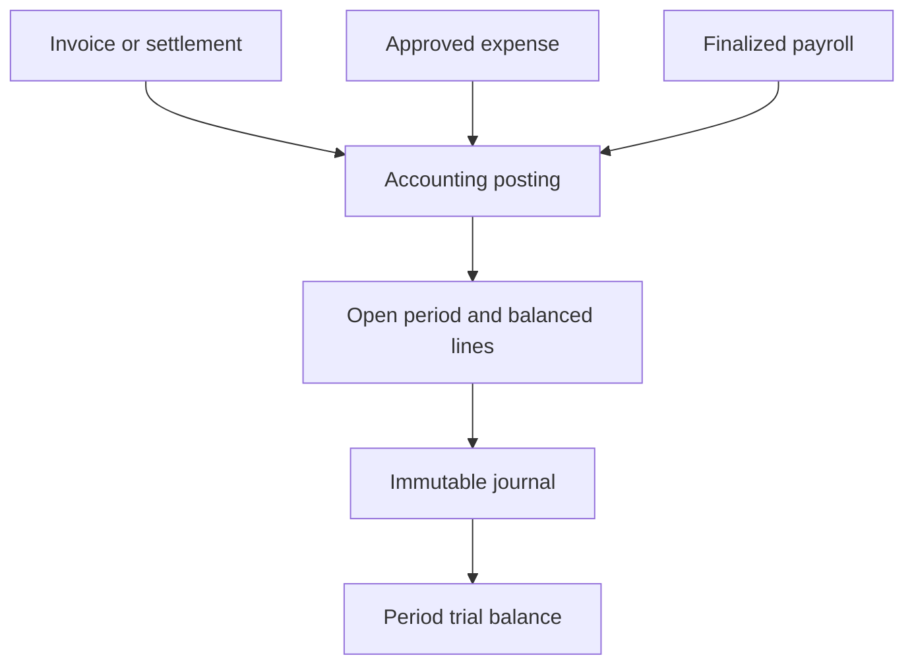
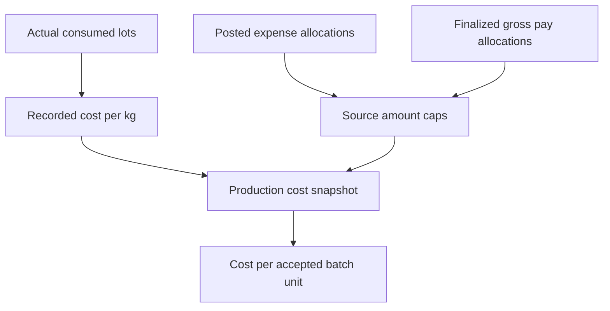
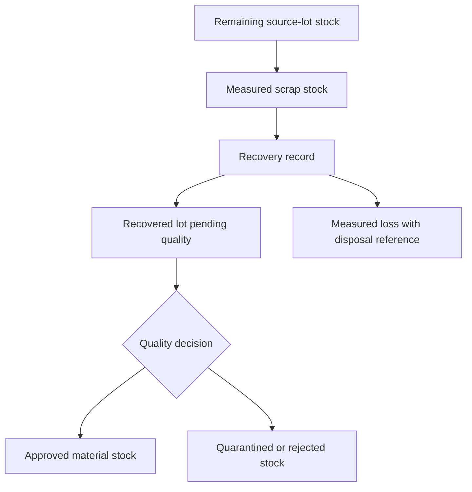

# Financial release · steps 26–30 · version 0.5

This release extends the same Java/Vue application. It is a modular monolith: modules have separate responsibilities and tables but share one backend deployment and transactional database. They are not independently deployed microservices.

| Step | Module | Implemented programming slice | Programmer role | Business role | Depends on |
|---|---|---|---|---|---|
| 26 | Accounting | Account types, currency periods, balanced immutable journals, manual reversals, trial balance, period closure | Backend + frontend | Accountant | Existing security and migrations |
| 27 | Invoices and settlements | Sales/purchase documents, explicit net/tax accounts, receivable/payable posting, partial settlements and outstanding balance | Backend + frontend | Finance manager creates; accountant posts | 26; external party/document references |
| 28 | Expenses and budgets | Period budgets, independent approval, cancellation, expense posting, closed maintenance/facility order evidence | Full-stack | Finance manager, finance approver, accountant | 19–20, 26 |
| 29 | Production costing | Immutable actual-cost snapshot, source-lot valuations, capped allocations from posted expenses and finalized gross payroll | Backend + frontend | Accountant | 14–15, 25, 28 |
| 30 | Recycling | Remaining raw stock → measured scrap → recovered lot; mass balance, loss evidence, quality gate and provenance | Full-stack | Production manager; quality manager releases lot | Incoming lots, quality, batch traceability |

## Concept diagrams







## Run and use

1. Retain your existing database volume and `.env`. Add `ACCOUNTANT_PASSWORD`, `FINANCE_PASSWORD` and `FINANCE_APPROVER_PASSWORD`, each a different random value of at least 16 characters. The v0.5 release added these to 18 required secrets; the current v0.6 `.env.example` requires 24 including the six integration/portal passwords. See INTEGRATION.md.
2. Rebuild the same Compose project: `docker compose up --build -d`. Flyway applies V5 once without changing V1–V4.
3. Open `http://localhost:8081`. Accounts `accountant`, `finance`, and `financeapprover` default to the Finance/costing workspace. The production/quality accounts can select the Recycling workspace. Quality decisions remain in the existing manufacturing workspace.
4. Accountant creates accounts and a two-decimal currency period. For invoices choose an asset receivable account on sales, liability payable on purchases, revenue on sales and expense/inventory asset on purchases. Positive tax requires the explicit liability/output-tax or asset/input-tax account respectively. No tax rate is inferred.
5. Finance manager creates a budget and expense; another person's finance-approver account approves it. Accountant posts it into the budget's accounting period. Cancel an unposted expense to release its budget commitment. Posted expense corrections are not yet supported.
6. Post invoices, then record actual statement-supported settlements. This changes recorded receivables/payables and bank/cash accounting, but sends no payment. Overpayments are rejected, and partial payments leave an outstanding balance.
7. Post a finalized two-decimal payroll period using wages expense, payroll payable and deductions liability accounts. Gross wages debit equals payable plus entered deductions credit. Employer charges and statutory deductions must be implemented separately; do not treat this as a legally complete payroll ledger.
8. Record evidence-backed per-kg lot valuations. Capture costs only for a completed production order with an approved batch. Optional allocations reference posted expenses or finalized individual gross-pay lines. The accountant can retrieve these lines from the costing screen. The combined allocations across all snapshots cannot exceed each source amount.
9. Production manager transfers remaining raw-material lot stock into scrap. Record weighed recovery with recovered mass no greater than input. Unrecovered mass requires disposal/loss evidence. The returned lot starts `PENDING`, and existing manufacturing quality checks block consumption until approval. This slice preserves the same raw-material SKU; it does not infer a new material grade or approve recipe substitution.

For a fictional complete example, run from the project root:

```bash
python3 scripts/demo_financial.py
```

The script also runs the manufacturing and workforce examples, creating new records. It creates ledger accounts, an accounting period, sales/purchase invoices and settlements, an approved energy expense, a payroll posting, an actual-cost snapshot, and a measured recycling recovery. It verifies a balanced trial balance, cost of 112.24 DZD and cost per accepted unit of 1.122400 DZD, and a recovered lot awaiting quality approval. Example amounts are invented, not statutory rates.

## Programming techniques and boundaries

- Java 17, Spring Boot, validated request records, Spring Security method authorization, JdbcTemplate and transactional services. No new runtime dependencies were added.
- V5 uses PostgreSQL-compatible UUID, foreign keys, checks, NUMERIC amounts and unique posting/source references. Financial transactions serialize on a database lock row to enforce caps and replay protection across processes; this favors correctness over high posting throughput.
- `AccountingService` owns accounting rules and document postings; `CostRecyclingService` owns analytic snapshots and material transfers. `FinanceStore` provides common lookup/validation/audit operations. `FinanceController` controls role access.
- Vue/TypeScript forms use normal account/document selectors, debit/credit rows, allocation rows, trial balance and provenance tables. Credentials stay in memory. Backend checks remain authoritative.
- Posted journals have no update/delete API. Reversal is a new balanced journal, only once, and only for manual entries. Invoice/expense/payroll correction and credit-note workflows are deferred so source balances cannot silently diverge from reversal entries.
- Manual journals and recovery/settlement requests use client event UUIDs. Repeat submissions return a conflict, not a second mutation. On an uncertain network response, refresh records before starting a new submission. Unique invoice party/document pairs and journal references also prevent ordinary duplicate entry.
- Trial balance is cumulative for the selected currency through the period’s exclusive end date, including earlier periods; it is not just the selected month’s movements. Accounting periods are per currency, start-inclusive/end-exclusive, cannot overlap and cannot reopen. Draft/approved expenses block closure until posted or cancelled. Invoices are created without an accounting-period association; draft invoices do not block closure.
- Monetary documents currently support currencies with two decimal minor units. Lot prices and per-unit costs use six decimal places; material cost rounds once after summing actual kg × lot value. Payroll posting/allocation requires a finalized period configured at scale two.
- Cost snapshot = consumed material cost + explicit allocations. All consumed material, including production loss/reject consumption, is charged to accepted output units. Snapshot captures quantities, prices, valuation evidence, allocation source IDs and reject quantities. It is an analytic report, not an inventory or cost-of-goods GL posting.
- Maintenance/facility expense links accept only closed work orders, enforce matching currency at approval and permit one active expense per order. Amount is manually evidence-backed, not automatically copied from internal labor/parts totals. Use external charges only; internal wages must stay in payroll rather than being entered again as an expense. Purchasing invoice and expense duplication under different references needs a future shared source-document registry.
- Recycling debits source remaining kg and maintains its own scrap stock. Recovery removes input kg, creates recovered stock, and records the remainder as loss. Duplicate or failed transactions roll back both movements. No mixing, scrap sales, hazardous-waste compliance, multi-grade recipes, virgin/regrind ratio enforcement, production-reject-to-kg conversion, or GL valuation of scrap is implemented. A virgin lot and recovered lot remain distinct traceable lot IDs under the same SKU.
- Recovery provenance returns immediate and upstream recovery edges (up to 1,000 generations), with original supplier references; manufacturing batch trace includes recovery links for consumed recovered lots. These are records, not physical scale/IoT commands.
- Version 0.6 adds optional AI assistance for production report summaries; see INTEGRATION.md. Invoice extraction remains pending, and no model approves expenses, payroll or accounting entries.
- Full purchasing/sales/warehouse services are still pending; supplier/customer/document references bridge those modules. Bank feeds, credit notes, currency exchange, statutory reporting, tax calculation and automatic perpetual inventory valuation are not included.
- Organization/factory scoping, PostgreSQL deployment, real OIDC acceptance and interactive browser acceptance still need a pilot validation. Read `VERIFICATION.md`.

## API map

Prefix `/api/v1/finance`. All writes use POST; creates return 201, most state transitions return 200.

| Resource | Endpoints | Write role |
|---|---|---|
| Accounts | `/accounts` | ACCOUNTANT |
| Periods | `/periods`, `/periods/{id}/close`; GET `/periods/{id}/trial-balance` | ACCOUNTANT |
| Journals | `/journals`, `/journals/{id}/reverse`; GET `/journals/{id}` | ACCOUNTANT |
| Invoices | `/invoices`, `/invoices/{id}/post`, `/invoices/{id}/payments` | Create: finance manager/accountant; post/settle: accountant |
| Expenses | `/budgets`, `/expenses`, `/expenses/{id}/approve`, `/expenses/{id}/cancel`, `/expenses/{id}/post` | Manager creates; approver approves; accountant posts |
| Payroll bridge | `/payroll/{id}/post`; GET `/payroll/{id}/lines` | ACCOUNTANT |
| Actual cost | `/lot-values`, `/costs` | ACCOUNTANT |
| Recovery | `/scrap`, `/scrap/{id}/recover`; GET `/recycling-overview`, `/recovery-trace/{lotId}` | PRODUCTION_MANAGER; quality reads and existing quality decisions |
| Financial overview | GET `/overview` | Accountant, finance manager, finance approver read |

No physical transfers or person-directed communications occur through these APIs. Configure the three financial roles in the existing Keycloak realm mapping when using the default bearer profile.
