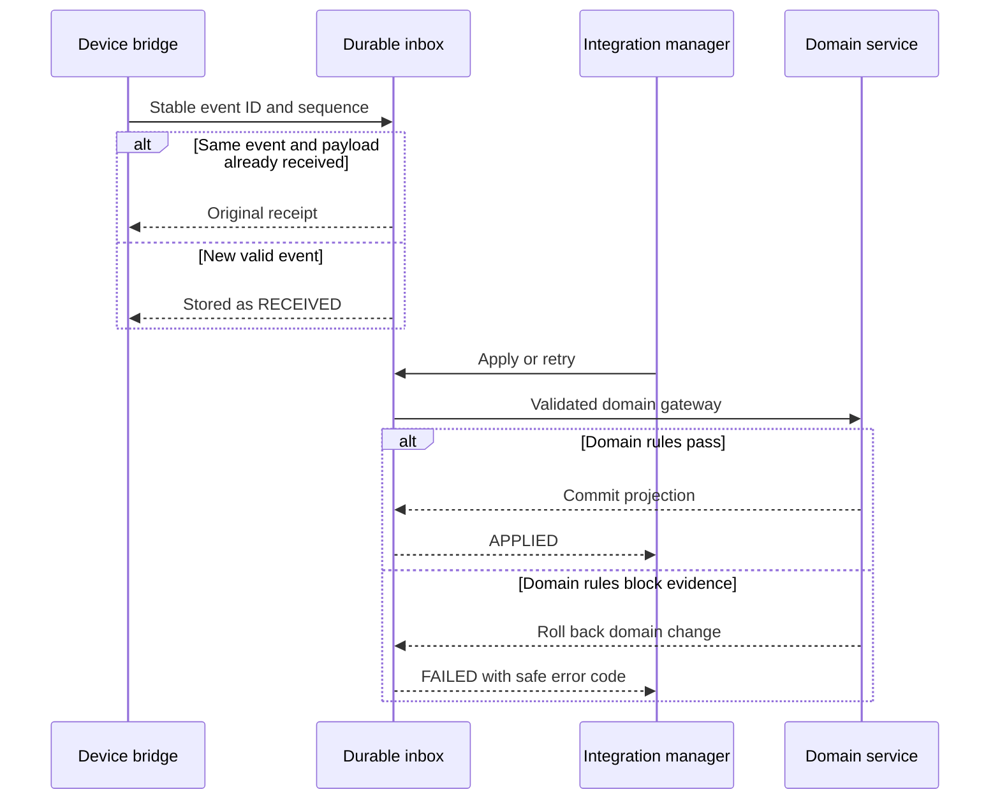
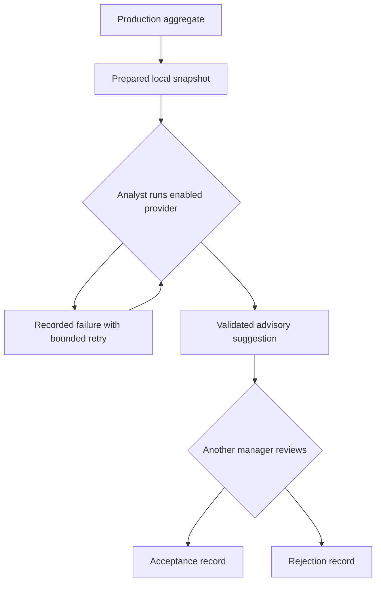

# Integration release · steps 31–35 · version 0.6

This release extends the accumulated Java/Vue ERP with device evidence, optional AI report assistance, reporting exports and company-scoped partner portals. Earlier modules and migrations remain in the archive. The backend is still one modular monolith and one transactional database; the Python device bridge runs separately at the factory edge. It is an adapter, not a split into independently deployed domain microservices.

## Programming steps and responsibilities

| Step | Application service | Implemented behavior | Programmer role | Business responsibility | Connections |
|---|---|---|---|---|---|
| 31 | Device registry | Dedicated agent identity, device type, camera/machine target, person/visit bindings, revocation and health timestamps | Backend + frontend | Integration manager provisions; identity provider authenticates | Machines, cameras, employees, truck visits |
| 32 | Device inbox and edge bridge | Durable event UUID/sequence, schema validation, offline SQLite outbox, explicit application, safe retries and failure evidence | Full-stack | Agent submits; manager applies; HR still validates attendance | Clock evidence, camera records, truck weights, sensor telemetry |
| 33 | AI assistance | Prepared production report snapshot, optional OpenAI adapter, bounded structured suggestions, failures/retries, separate human review | Backend + frontend | Analyst prepares/runs; another integration manager reviews | Production output report only |
| 34 | Reports and exports | UTC output report by SKU/unit, device health/inbox counts, cumulative financial balance export | Backend + frontend | Report viewer reads operations; finance roles read ledger reports | Actual output, devices and posted accounting |
| 35 | External portals | Customer requests, supplier offers, delivery notices, published products, own posted invoices and factory replies | Full-stack | Partner submits; integration manager reviews | Catalog and external invoice party references |

## Concept design





Acceptance records review only. Approved business changes must still go through the original production, maintenance, payroll or accounting workflow. AI has no business mutation tools.

| Portal boundary | Source of authority | Data visible |
|---|---|---|
| Authenticated account | OIDC subject, or explicit local demo username | No caller-selected company ID |
| Partner association | Active `int_partner_user` and `int_partner` binding | One company per subject |
| Catalog | Explicit publication plus active product | SKU, name, kind and unit; no stock balances or internal prices |
| Invoice list | Exact partner party reference, matching SALE/PURCHASE kind, POSTED state | Totals, currency, due date and outstanding amount; no GL accounts |
| Requests | Stored partner ID derived from account binding | Own requests and factory replies |

## Setup and use

1. Keep `.env`, the existing database volume and the same Compose project name. Add six passwords: `INTEGRATION_PASSWORD`, `REPORTS_PASSWORD`, `DEVICE_PASSWORD`, `CUSTOMER_PASSWORD`, `CUSTOMER2_PASSWORD`, `SUPPLIER_PASSWORD`. Use different random values of at least 16 characters. The current example has 24 required secrets: one database password and 23 demo users. Optional AI settings are separate.
2. Rebuild with `docker compose up --build -d`. Flyway applies V6 once and retains V1–V5. The Vue UI remains `http://localhost:8081`.
3. Log in as `integration` for Devices, Partners, Reports and AI management; `reports` for reports and AI drafts. Partner accounts `customer`, `customer2`, `supplier` use the partner portal after a manager creates their company and account binding. The demo `device` account is for the bridge/API, not an operator UI login.
4. Register an attendance device with principal `device` for local demonstration. Bind its external person identifier to a current employee. Fingerprint recognition occurs in the physical device/vendor software; this application accepts an identifier and clock kind only, never a fingerprint image/template.
5. Receive a device event with the agent account. The manager applies it from the inbox. HR then uses the existing attendance validation process. Device evidence does not generate approved attendance, overtime, wages or physical access permissions.
6. Publish selected products, register partners using the exact existing invoice party references and bind the correct account subjects. Create those accounts in your identity provider separately; the ERP binding does not create accounts or send invitations.
7. A customer may submit `SALES_REQUEST`, a supplier `SUPPLY_OFFER`, and either may submit `DELIVERY_NOTICE`. The manager acknowledges or declines with a visible reply. Acknowledgement does not create a sales/purchase order, reserve stock, confirm price or book a truck.
8. Use the Reports view with UTC dates, start-inclusive/end-exclusive, up to 93 days. Output stays grouped by SKU/unit so pieces and kilograms are never combined. Financial CSV is available in the existing Finance → Accounting view after selecting a period. It includes earlier account balances through the selected period's end.

For a full fictional workflow on a **fresh disposable local stack**, run from project root:

```bash
python3 scripts/demo_integration.py
```

It first runs the earlier manufacturing, workforce and financial examples, then exercises the actual device outbox → inbox → clock gateway, partner isolation, request review, posted-invoice view, output CSV and local AI draft. It sends no paid AI request and does not operate hardware. This example needs an unbound demo device principal; use existing records after the first run rather than resetting real data.

## Device API and offline bridge

Production uses dedicated OIDC service-account subjects with `DEVICE_AGENT`. Register each exact subject as one device principal. Use HTTPS in the deployment reverse proxy. Local Basic credentials are only the explicit demo profile. The agent cannot choose an employee ID, camera or machine outside its configured binding. Scales require a per-visit allowlist. All device events enter the inbox before manager application.

POST `/api/v1/integration/device-events`:

```json
{
  "eventId": "4f9c10e6-b40e-4e3d-9e42-2b13ce64dc5d",
  "sequence": 1,
  "occurredAt": "2026-10-14T12:00:00Z",
  "data": {"person": "reader-person-42", "kind": "IN"}
}
```

The timestamp is illustrative; use current recorded UTC evidence for testing.

| Registered device | Exact `data` fields | Application behavior |
|---|---|---|
| ATTENDANCE | `person`, `kind`: IN/OUT/BREAK_START/BREAK_END | Raw employee clock through the payroll gateway; no automatic approval |
| CAMERA | `state`: ONLINE/OFFLINE/MAINTENANCE | Existing camera status record; older/equal timestamps become IGNORED |
| SENSOR | `value`: bounded numeric string | Stored telemetry for the configured machine/metric/unit; no machine setting changes |
| SCALE | `visitId`, `kind`: TARE/GROSS, `kg`: positive numeric string | Existing yard weight rules, gate-approved stage, visit time and gross/tare checks |

Identifiers/sequences are stable across retries. Reusing an ID with another payload/device or reusing a device sequence is rejected. Accepted events allow up to 30 days of offline age and five minutes of future clock skew. Camera devices have one active updater per camera. Person and visit bindings are immutable in this slice; use a new person identifier or provision a replacement device identity when needed. Revocation blocks both new receipts and projection of queued records.

`APPLIED`/`IGNORED` application retries return the same result. Domain validation failures are recorded as `FAILED`, with at most ten manager application attempts. Database constraint conflicts also become FAILED; transient locking/storage errors can leave the event RECEIVED for later retry. Correct the referenced domain state or binding before retrying. An invalid measured payload cannot be edited; submit corrected evidence under a new event ID, preserving the rejected record.

The edge adapter uses Python standard libraries and SQLite only. A vendor-specific driver produces a small JSON file containing `occurredAt` and the appropriate `data`; the bridge enqueues it once and sends a bounded batch. It does not connect directly to any proprietary reader, VMS, camera, industrial PLC, MQTT broker, OPC-UA server or scale protocol.

```bash
python3 scripts/device_bridge.py --outbox device-outbox.sqlite enqueue --file clock-event.json
python3 scripts/device_bridge.py --outbox device-outbox.sqlite flush --url https://your-erp.example
python3 scripts/device_bridge.py --outbox device-outbox.sqlite status
```

Set `PLASTIFLOW_DEVICE_TOKEN` in the agent environment. For the localhost demo set `DEVICE_PASSWORD` and add `--allow-local-demo` to flush. Credentials do not go in payloads or CLI arguments, redirects never forward them, and non-loopback plaintext HTTP is rejected.

Transport failures and expired credentials retain the original event with exponential retry delay capped at 300 seconds. Nonretryable HTTP rejection moves it to DEAD. After resolving the cause, `retry --event-id UUID` requeues the original payload. Preserve the SQLite file across agent restarts: it owns the sequence counter. Run one flush worker per outbox; parallel workers may send duplicate receipts, which the backend safely deduplicates. Periodic execution belongs in the edge host's process manager/task scheduler; no remote scheduled job is installed by this archive.

## Optional AI adapter

The implementation follows the [official OpenAI structured-output documentation](https://developers.openai.com/api/docs/guides/structured-outputs?api-mode=responses), retrieved during this release. It uses the fixed Responses API endpoint and a strict JSON schema. No runtime endpoint can be supplied by a request.

To enable it in your deployment, set server-side environment values:

```dotenv
PLASTIFLOW_AI_ENABLED=true
PLASTIFLOW_AI_MODEL=your-accessible-structured-output-model
OPENAI_API_KEY=your-server-side-key
```

The model value above is a placeholder, not an actual model name. Choose a model available to your account that supports Responses structured outputs. The default remains disabled. No secrets are stored in the code, frontend or AI job table.

An analyst prepares a snapshot of product names/SKUs, units and aggregate output counts, then reviews the displayed data and explicitly runs it. The provider receives that fixed snapshot, even on retries. Payroll, employee identities, attendance, camera imagery, invoice records and ledger details are not sent. Product names may contain commercially sensitive text: review the actual snapshot before running it.

The request sets `store:false`, caps output at 1,200 tokens and uses a 20-second call limit with a bounded 128 KiB response body. These controls do not constitute a promise about provider retention or billing. The application validates the returned summary and suggestion lengths again. Refusals, incomplete responses, invalid schema and transport failures publish no suggestion and become a safe failure code; provider response bodies, exception details and credentials are not exposed.

At most five new drafts per analyst per minute, two provider calls globally at once and three attempts per job are allowed. Running a successful job again is rejected. Only its creator can send the snapshot to the provider. Another integration manager records acceptance/rejection. A RUNNING job interrupted for over two minutes can be marked failed and retried; attempt checks prevent a stale completion from overwriting a newer run.

Live paid-provider execution has not been performed in this environment. Tests use a mocked provider and a local HTTP contract fixture clearly named as fixtures, not generated model results. Preparing a QUEUED draft while the provider is disabled is not an AI generation.

## Programming techniques

- Java 17/Spring Boot method security, validated DTOs, Flyway V6, database constraints and transactional JDBC services. No additional Java runtime dependencies.
- `DeviceService` owns registration, schema checks and inbox projection. Public `ClockGateway`/`DeviceGateway` reuse existing domain rules instead of bypassing approval or weight validation. The inbox audit records both source device and manager projection.
- `PortalService` resolves partner scope from the authenticated subject for every read/write. Controllers never accept a caller-supplied company ID for portal scope. Revoked partner/user access takes effect on the next request.
- `ReportService` reads output and product context in one bounded query, then groups exact BigDecimal amounts by SKU. CSV quotes delimiters/newlines and prefixes formula-leading cells to prevent spreadsheet execution. Financial reports use the same cumulative currency/date rule as accounting.
- `AiService` commits job claims before network calls, performs HTTP outside database locks, then commits validated results with attempt checks. `OpenAiProvider` is behind a replaceable interface and limits streaming body size. Prepared inputs and suggestions remain auditable.
- Vue/TypeScript adds manager actions, normal selectors and portal product rows, CSV downloads and a reviewable AI snapshot/suggestion view. No raw credential persistence or unsafe HTML rendering is added.
- The existing backend remains a modular monolith. V6 adds its own tables and cross-module gateways. Before introducing microservices, add the still-missing organization scoping and deployment acceptance, and identify a measured independent scaling requirement.

## API map

| Area | API paths | Authority |
|---|---|---|
| Registry | POST `/integration/devices`, `/devices/{id}/identities`, `/devices/{id}/visits`, `/devices/{id}/revoke` | INTEGRATION_MANAGER |
| Device ingest | POST `/integration/device-events` | DEVICE_AGENT bound to registered principal |
| Inbox projection | POST `/integration/events/{id}/apply` | INTEGRATION_MANAGER |
| Operational reports | GET `/integration/reports/production`, `/production.csv`, `/device-health` | REPORT_VIEWER |
| Financial reports | GET `/integration/reports/financial/{id}`, `/financial/{id}.csv` | ACCOUNTANT or FINANCE_MANAGER |
| AI | GET `/integration/ai`, `/ai/jobs/{id}`; POST `/ai/jobs`, `/ai/jobs/{id}/run`, `/recover` | AI_ANALYST; owner restrictions apply |
| AI review | POST `/integration/ai/jobs/{id}/review` | INTEGRATION_MANAGER, different principal |
| Partner setup | POST `/integration/partners`, `/partners/{id}/users`, `/partners/{id}/revoke`, `/partner-users/{subject}/revoke` | INTEGRATION_MANAGER |
| Publication | POST/DELETE `/integration/published-products/{productId}` | INTEGRATION_MANAGER |
| Factory reply | POST `/integration/portal-requests/{id}/decision` | INTEGRATION_MANAGER |
| Partner view | GET `/portal/overview`, `/portal/requests/{id}`; POST `/portal/requests` | PORTAL_USER plus active company binding |

All paths above are under `/api/v1`; abbreviated suffixes belong to the same area prefix. Configure the five new OIDC roles in the existing realm role mapping. Demo role assignments are in `DemoSecurityConfiguration`.

## Remaining integration work

Vendor drivers, broker subscriptions, biometrics recognition, video ingestion/streaming, machine command channels and physical gates remain external implementations. The portal uses current invoice references and request records because complete sales/purchasing/reservation services are still pending. It has no self-signup, invitation sending, online payment, partner-specific pricing, document uploads, multi-company-per-subject association, or SLA workflow. Portal catalog publication is shared across partners; invoices/requests are company-scoped.

Operational reports are output snapshots and current device state, not certified OEE, machine-speed analysis, payroll compliance, statutory statements or a data warehouse. Internal manager roles remain global; organization/factory scoping is still pending. PostgreSQL/container deployment, real OIDC-device authentication, interactive browser acceptance and a live configured AI provider must be accepted before a pilot. See VERIFICATION.md for what was actually checked.
