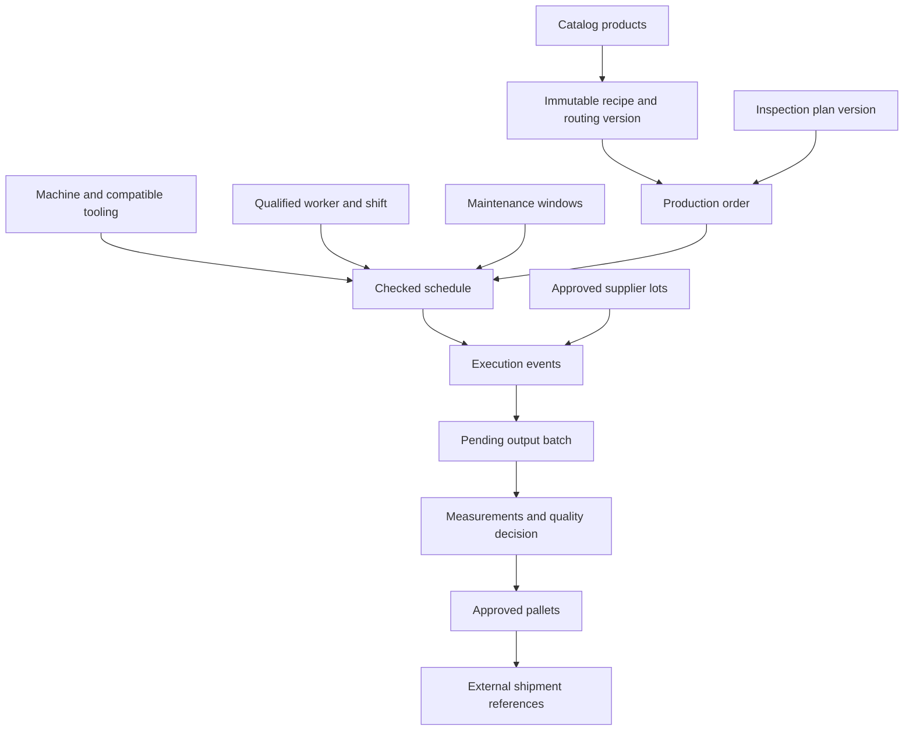
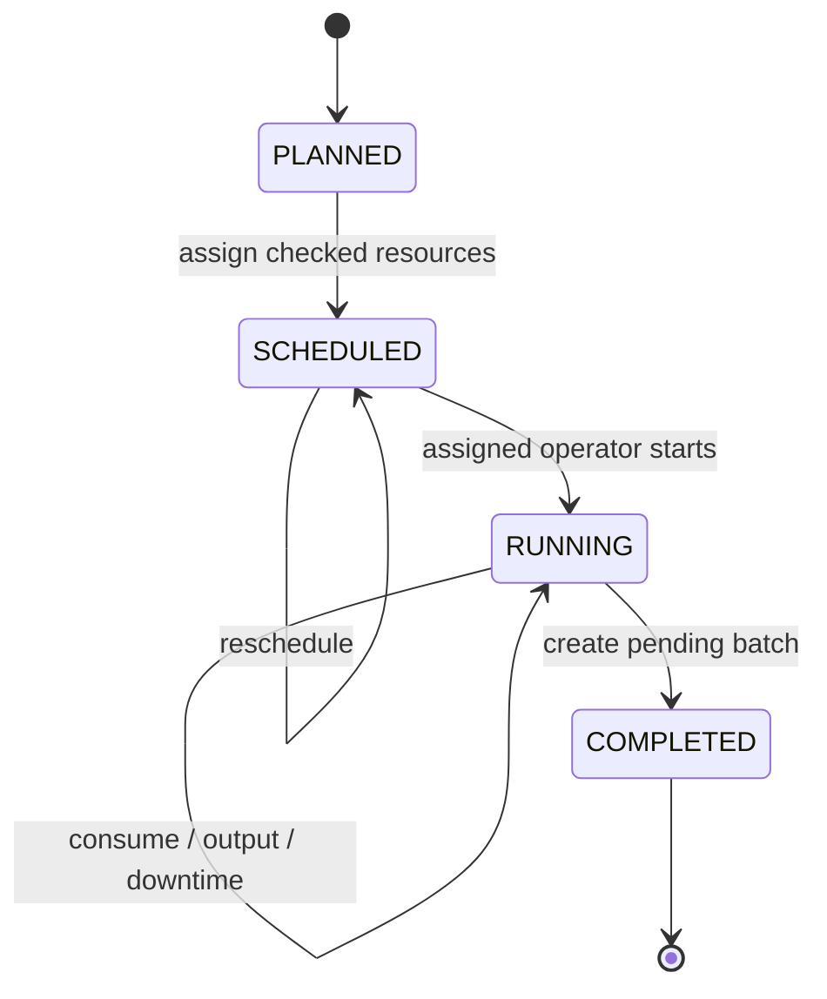
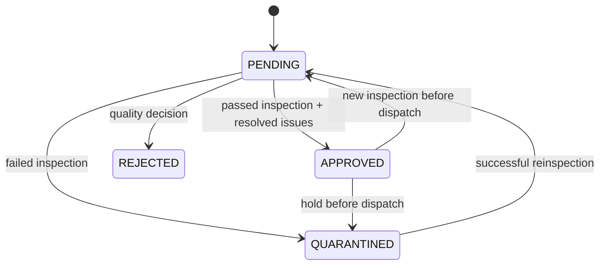

# Manufacturing increment: programming steps 11–18

This increment extends the original catalog project. It supplies runnable foundations for the eight requested areas, plus small integration bridges for material lots and external sales/supplier/shipment references. It does **not** implement the missing purchasing, sales, warehouse, reservation or invoicing modules from steps 1–10.

| Step | Implemented behavior | Frontend workspace |
|---|---|---|
| 11 | Machines, process, maximum material per job, molds, cavities, approved machine–mold links, availability | Equipment |
| 12 | Immutable numbered recipe versions, kg-per-output-unit components, ordered operations, process-setting reference values and packaging instructions | Recipes |
| 13 | Production orders linked to immutable recipe and inspection-plan versions; planned material requirements, usable stock and shortages | Production |
| 14 | Assigned-operator job start, actual lot consumption, output/reject events, downtime intervals, completion into a pending batch | Production |
| 15 | Versioned inspection plans, exact metric entry, limit checks, quarantine, nonconformities, resolution and explicit batch release | Quality |
| 16 | Backward/forward lot genealogy, approved-output pallets and links to external shipment/customer references | Traceability |
| 17 | Employee identity association, per-machine qualifications with expiry, nonoverlapping shifts and job assignments | Workforce |
| 18 | Machine calendar, manual scheduling/rescheduling, process/capacity checks, machine/mold/worker overlap prevention, shift/qualification checks and maintenance windows | Scheduling |

## Run the application

From the project root copy `.env.example` to `.env`. For version 0.3, also add the six operations passwords from FACTORY_OPERATIONS.md. Version 0.4 additionally needs the two payroll passwords. Version 0.5 adds three financial passwords and version 0.6 adds six integration/portal passwords. Set **all 24** current database/account passwords to distinct random values of at least 16 characters. Then:

```bash
docker compose up --build -d
```

- Vue workspace: `http://localhost:8081`
- Backend: `http://localhost:8080`
- Health: `http://localhost:8080/actuator/health`

Use account `production`, `quality`, `workforce` or `operator` and the corresponding password from `.env`. Switch accounts using Sign out. Catalog creation remains available through the existing manager API or the demonstration script. The Compose installation is local-only and not production deployment.

For frontend development install Node.js 24 and run:

```bash
cd frontend
npm ci
npm run dev
```

The development server proxies `/api` to a backend on localhost:8080. `npm run build` performs TypeScript checking and creates the production frontend. No credentials are saved to localStorage. The OIDC token option accepts an access token supplied by the developer; a complete browser login/PKCE flow is still pending.

### API-driven example

With the demo stack running, run this from the root directory:

```bash
python scripts/demo_manufacturing.py
```

It reads configured manager passwords from `.env` or environment variables. It creates one catalog pair, compatible machine/mold, qualified employee, shift, recipe, inspection plan, order and incoming lot; then schedules, starts, consumes, records output, completes, inspects, releases, packs and links an external dispatch reference. It prints the created identifiers and verifies the trace. Each run creates a new example, not a reset of existing data.

Open the Vue workspace afterward to inspect the records. This example is fictional: process settings and quality limits are not factory-approved specifications.

## Important rules and limits

- `capacityKg` means the configured maximum **total planned material per job**, not hourly throughput, clamp force or machine shot capacity. More detailed machine-specific capability models are pending.
- Recipe components are kilograms per one output base unit. Material products must have kind RAW_MATERIAL and base unit KG. Finished products use their catalog base unit; PIECE quantities must be whole numbers.
- Planned material = `planned output × kg per unit / yield factor`, rounded upward to six decimal places.
- Recipes and inspection plans are immutable. Creating another version never changes existing orders. Process settings are instructions only; no machine commands are sent.
- Scheduling is manual and checks constraints. It is not automatic optimization. Routing estimates are sequential minutes per output unit and must fit the schedule; cavities are recorded but do not automatically alter duration.
- Available-stock estimates are not reservations. Multiple planned jobs can need the same material. Actual consumption uses transactional lot locks and cannot make remaining stock negative.
- Incoming lots begin PENDING. Only quality-manager approval makes them usable. Consumption is an append-only record with its corresponding lot decrement in the same transaction. Transfers, reservations, stock counts and reversal workflows are still pending.
- Start is permitted only within the schedule, and a machine, mold or employee cannot execute two RUNNING jobs. Qualifications are checked at scheduling and start. Dates are interpreted in UTC for qualification expiry; qualification remains valid through the selected UTC date.
- `goodQty` means candidate-good production, not quality-released output. Candidate-good output may not exceed the job plan in this increment. Rejects are separate. Overproduction approval and mass-balance validation are pending.
- Completion requires candidate-good output and recorded consumption for each recipe component. Completing below target closes this job only; it does not fulfill an external sales order or automatically create replacement demand.
- Consumption/output requests use client UUID event IDs. Exact retries are safe; changing payload under the same event ID returns a conflict. Other create operations are not universally idempotent.
- Operators can execute only jobs assigned to an employee whose `userSubject` matches the authenticated subject (demo username or OIDC sub). Production managers can execute jobs across this prototype.
- New inspections reset prior approval. Failed limits create an unresolved nonconformity. Approval requires the latest inspection to pass and all nonconformities to be resolved.
- Only approved batches can be packed or linked to dispatch. Pallet allocation cannot exceed batch quantity. One pallet can be linked once. These are genealogy references; they do not create a commercial shipment, delivery note or finished-goods stock issue.
- Once a batch is linked to dispatch, quality changes are blocked. A recall workflow must be added instead of rewriting dispatch history.
- An append-only manufacturing audit table records actor, action, entity, time and decision reasons. A privileged audit-report UI, tamper-resistant storage and complete cross-module auditing remain pending.
- Overview lists are bounded to 200 records; product options are bounded to 100. Server-side filters and pagination must be added for larger deployments.
- Current UI is English and the data scope is global. Multi-factory isolation, department-level read restrictions and French/Arabic localization remain pending.

## Concept diagrams







## API endpoints

All paths below start with `/api/v1/manufacturing`. Use the request records in `Requests.java` for exact validated JSON fields. Read operations require one manufacturing role. Writes enforce the listed roles.

| Method and path | Role | Function |
|---|---|---|
| GET /overview | Manufacturing role | Bounded workspace data |
| POST /machines; POST /molds | PRODUCTION_MANAGER | Register equipment |
| PUT /machines/{machine}/molds/{mold} | PRODUCTION_MANAGER | Approve compatibility |
| PUT /machines/{id}/state; PUT /molds/{id}/state | PRODUCTION_MANAGER | Set availability |
| POST /recipes; GET /recipes/{id} | Production manager / read role | New version / version detail |
| POST /employees | WORKFORCE_MANAGER | Employee and identity link |
| PUT /employees/{id}/qualifications | WORKFORCE_MANAGER | Set expiry for machine qualification |
| POST /shifts | WORKFORCE_MANAGER | Create employee shift |
| POST /orders; GET /orders/{id} | Production manager / read role | New job / requirements and actuals |
| PUT /orders/{id}/schedule | PRODUCTION_MANAGER | Schedule or reschedule |
| POST /maintenance-blocks | PRODUCTION_MANAGER | Block a free machine interval |
| POST /lots | PRODUCTION_MANAGER | Register external receipt lot |
| PUT /lots/{id}/quality | QUALITY_MANAGER | Incoming material decision |
| POST /orders/{id}/start | OPERATOR or PRODUCTION_MANAGER | Start ERP job |
| POST /orders/{id}/consumptions | OPERATOR or PRODUCTION_MANAGER | Actual material consumption |
| POST /orders/{id}/outputs | OPERATOR or PRODUCTION_MANAGER | Candidate-good and reject output |
| POST /orders/{id}/downtime | OPERATOR or PRODUCTION_MANAGER | Downtime interval |
| POST /orders/{id}/complete | OPERATOR or PRODUCTION_MANAGER | Close job into pending batch |
| POST /inspection-plans | QUALITY_MANAGER | Create immutable specification |
| POST /batches/{id}/inspections | QUALITY_MANAGER | Evaluate measurements |
| PUT /batches/{id}/quality | QUALITY_MANAGER | Explicit disposition |
| PUT /nonconformities/{id}/resolve | QUALITY_MANAGER | Record resolution reason |
| POST /pallets | PRODUCTION_MANAGER | Allocate approved output |
| POST /dispatch-references | PRODUCTION_MANAGER | Link external shipment/customer |
| GET /batches/{id}/trace; GET /lots/{id}/trace | Manufacturing role | Backward and forward genealogy |

For OIDC, add PRODUCTION_MANAGER, QUALITY_MANAGER, WORKFORCE_MANAGER and OPERATOR to `realm_access.roles` as required, with the existing issuer/audience configuration. User identity references must use the token subject, not the display name.

## Code organization

- `EquipmentService`: machine/tool configuration.
- `RecipeService`: immutable recipes and routings.
- `WorkforceService`: employees, qualifications and shifts.
- `ScheduleService`: scheduling and maintenance-block checks.
- `ProductionService`: job lifecycle and actual production records.
- `QualityService`: inspection, holds, release and nonconformities.
- `TraceService`: packing and genealogy references.
- `Store`: parameterized SQL, common record lookup, decimal/date handling and audit insertion.
- `ManufacturingController`: validated HTTP contracts and role authorization.

Manufacturing uses Spring JDBC inside transactions against the same PostgreSQL database as the JPA catalog. SQL values are bound parameters. Resource rows are locked before checking shared availability. This is a modular application foundation, not independently deployed department microservices.
