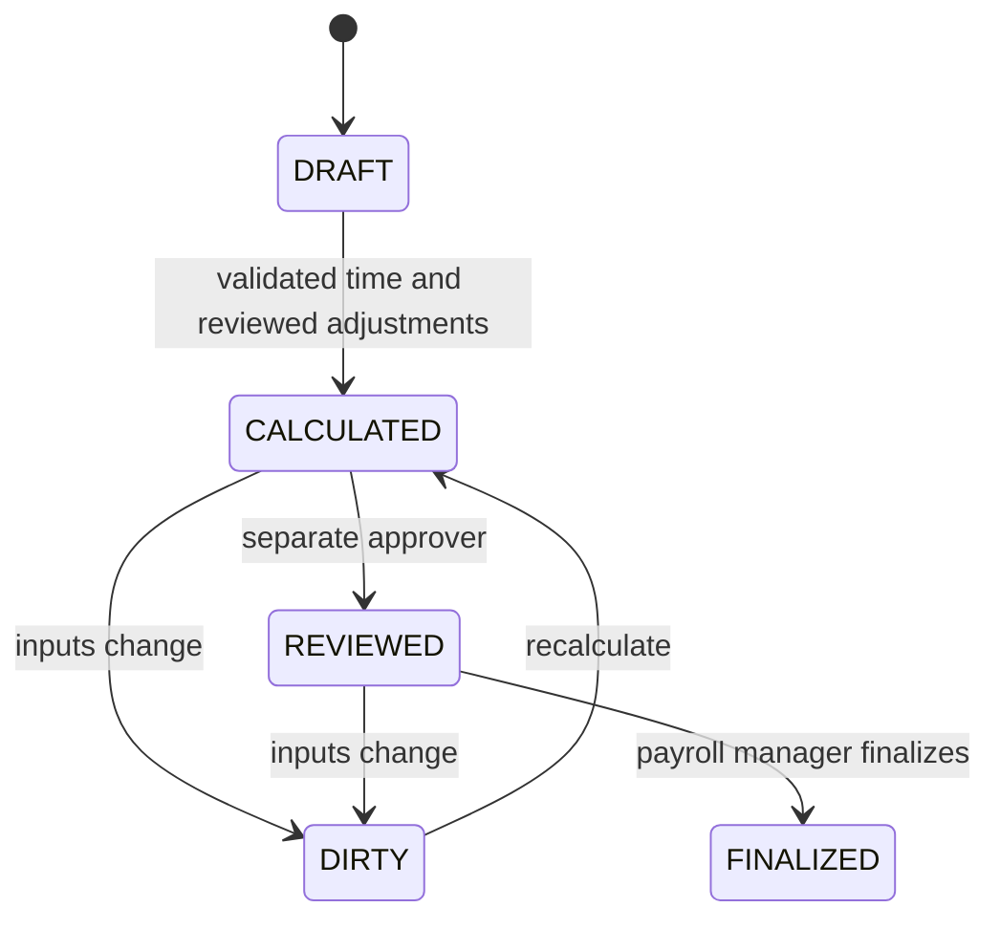

# Workforce release: programming steps 23–25

Version 0.4 adds attendance validation and approved payroll calculations to the previous application. This is a configurable payroll foundation, not a country-certified payroll or payment system.

| Step | Implemented |
|---|---|
| 23 | Immutable clock evidence; attendance drafts; unpaid break intervals; overlap checks; approved overtime classification; revision-based corrections/voids; paid/unpaid leave and absences |
| 24 | Immutable effective-dated hourly/monthly wages; local night windows; percentage/fixed night premiums; overtime percentages; additive/multiplicative stacking; approved bonuses/deductions |
| 25 | Pay-period membership; calculation snapshots; separate reviewer; review invalidation after input changes; immutable finalization; printable employee statements |

## Run / upgrade

Preserve `.env` and database volumes. Add `PAYROLL_PASSWORD` and `PAYROLL_APPROVER_PASSWORD` from `.env.example`. The current accumulated v0.6 application requires all 24 configured secrets: one database password and 23 demo account passwords; see INTEGRATION.md for the later additions. Use distinct passwords of at least 16 characters.

```bash
docker compose up --build -d
```

Open `http://localhost:8081`. Use:

| Account | Role | Access |
|---|---|---|
| workforce | WORKFORCE_MANAGER | Employees/shifts, clock evidence, attendance and absence approval |
| payroll | PAYROLL_MANAGER | Wage/rule versions, periods, adjustments, calculation and finalization |
| payrollapprover | PAYROLL_APPROVER | Adjustment decisions and separate payroll review |

The workforce account initially opens attendance; choose Manufacturing to manage employees/qualifications/shifts. Payroll accounts open the pay workspace. For OIDC choose Attendance/payroll and the appropriate view. Configure PAYROLL_MANAGER and PAYROLL_APPROVER in realm roles with the existing issuer/audience validation. Full browser PKCE login remains pending.

Flyway adds V4 and retains previous migrations. PostgreSQL/container execution and browser acceptance remain pilot checks.

Run an API example from the root:

```bash
python scripts/demo_workforce.py
```

It creates a fictional employee, wage, rule, cross-midnight shift with a break, approved overtime, bonus and finalized period. It uses a new future date after visible existing periods/rules so repeated demos do not change frozen periods. Do not run demonstrations against real payroll data.

## Attendance design

Clock events have a unique UUID, employee, kind, original timestamp and source. Exact retries are safe. The system does not automatically pair punches or infer payable time: a workforce manager creates and approves the attendance interval, optionally linking original evidence.

- Attendance and breaks use whole-minute timestamps and elapsed-time intervals up to 24 hours. Longer leave spans need daily paid-time records.
- Breaks must lie inside attendance and cannot overlap.
- Active attendance cannot overlap another attendance or absence.
- Net paid minutes = elapsed attendance minutes − unpaid break minutes.
- Approved overtime minutes classify the **last N paid minutes** in that record. They do not add extra minutes or duplicate base pay.
- Unpaid breaks do not earn night premiums. Manager-approved time is the payable scope; there is no automatic statutory daily/weekly overtime threshold.
- Corrections retain the original as SUPERSEDED and create a new DRAFT requiring approval. Voids retain the original record with an audit reason.
- Leave/absence records require approval. PAID_LEAVE earns base pay only; UNPAID_LEAVE and ABSENCE earn zero. Record the intended paid working hours, not an entire calendar day by default.
- Finalized-period guards block changes to intersecting attendance/absence inputs. Raw evidence can still be captured later, but does not itself recalculate approved time.
- Attendance approval is not automatically checked against the production shift calendar; the calendar is displayed for human reconciliation. Automatic punch pairing, leave balances, employee self-service and device ingestion are pending.

## Wage and premium design

Every wage and premium rule is immutable and has an effective date. Existing versions cannot be edited. The period defines its IANA time zone, currency and monetary decimal places; start date is inclusive, end date exclusive.

The calculator iterates actual elapsed minutes, converts each minute into the period's local time and selects the wage/rule effective on that local date. This handles midnight boundaries, version changes and daylight-saving transitions without counting nonexistent or repeated wall-clock hours incorrectly.

### Pay basis

- HOURLY: base per minute = hourly rate / 60; monthlyMinutes must be 0.
- MONTHLY: base per minute = configured monthly salary / contractual monthly paid minutes.

Monthly pay is therefore explicit attendance-based proration. It is not a complete fixed-month salary policy. Salary guarantees, statutory leave treatment and country-specific proration rules must be configured separately.

### Night and overtime

Night windows are half-open, for example [22:00, 06:00), and may cross midnight.

- PERCENT night extra per minute = base per minute × nightValue / 100.
- FIXED night extra per minute = configured extra amount per hour / 60, in period currency.
- Overtime extra = base per minute × overtimePercent / 100.
- ADDITIVE overlap: night and overtime extras are both calculated from base.
- MULTIPLICATIVE overlap: overtime extra is calculated from base plus the night extra.

Base pay is counted once. Paid leave has neither night nor overtime premium in this foundation. Different factory agreements require explicit additional policies.

Example: hourly wage 60 DZD, shift 20:00–04:00 UTC, unpaid break 23:00–23:30, night premium 25%, and 60 approved overtime minutes with additive 50% extra:

| Component | Result |
|---|---:|
| Paid worked minutes | 450 |
| Night worked minutes | 330 |
| Base pay | 450.00 DZD |
| Night extra | 82.50 DZD |
| Overtime extra | 30.00 DZD |
| Gross before bonus | 562.50 DZD |
| Approved example bonus | 20.00 DZD |
| Gross with bonus | 582.50 DZD |

Intermediate arithmetic uses decimal values. Each pay component is rounded HALF_UP to the period's chosen money scale, then components are summed. Currency compatibility is enforced; automatic currency conversion is absent.

## Approval and immutable payroll



- Payroll period membership is explicit; the same employee cannot belong to overlapping periods, even with different time zones.
- Draft attendance/absence and undecided adjustments block calculation.
- Only approved adjustments affect pay; rejected adjustments remain as history.
- New overlapping time or effective wage/rule changes invalidate calculated/reviewed periods. A DIRTY period cannot be finalized.
- Payroll reviewer must be a different authenticated person from the calculator.
- Finalized payroll cannot be recalculated, and backdated input/rule changes affecting it are rejected.
- A later correction can be represented as an approved adjustment in a separate later period, with its original reference in the reason. A formal correction ledger/accounting reversal workflow is still pending.
- Each pay line stores wage/rule snapshots, classified minutes, adjustment records, source attendance IDs and rounding policy. No future rule changes rewrite those saved results.

Gross = base + night extra + overtime extra + approved bonuses. Payable = gross − approved entered deductions. Negative payable is rejected. **Statutory taxes, employee/employer contributions, pension, benefits and bank payment submission are not implemented.** Printed statements carry this limitation and the period status.

## Privacy and implementation boundaries

HR attendance access does not grant access to wages/payroll. Payroll roles do not get the HR attendance overview or absence reasons. Employee self-service statements, factory isolation, retention controls and complete external audit exports remain pending.

A workforce transaction lock serializes mutations and payroll snapshots in this small-factory implementation. Lists show at most 200 records and period membership is capped at 500 employees. The minute-by-minute engine prioritizes explainability; larger installations need interval segmentation, pagination and finer-grained locking after benchmarks.

## API map

All routes start with `/api/v1/payroll`. JSON contracts are in `payroll/Requests.java`.

| Routes | Role |
|---|---|
| GET /attendance-overview | WORKFORCE_MANAGER |
| POST /clock-events; POST /attendance; POST /absences | WORKFORCE_MANAGER |
| POST /attendance/{id}/approve, /corrections, /void | WORKFORCE_MANAGER |
| POST /absences/{id}/approve, /cancel | WORKFORCE_MANAGER |
| GET /overview; GET /periods/{id} | PAYROLL_MANAGER or PAYROLL_APPROVER |
| POST /wages; POST /rules; POST /periods | PAYROLL_MANAGER |
| POST /periods/{id}/adjustments; POST /periods/{id}/calculate | PAYROLL_MANAGER |
| POST /adjustments/{id}/decision | PAYROLL_APPROVER |
| POST /periods/{id}/review | PAYROLL_APPROVER |
| POST /periods/{id}/finalize | PAYROLL_MANAGER |

Authentication/role failures return 401/403. Invalid inputs return 400; state, frozen-period and other business conflicts return 409. Event replay protection currently applies to raw clock capture; attendance drafts and period actions have their own state checks rather than universal create idempotency.
